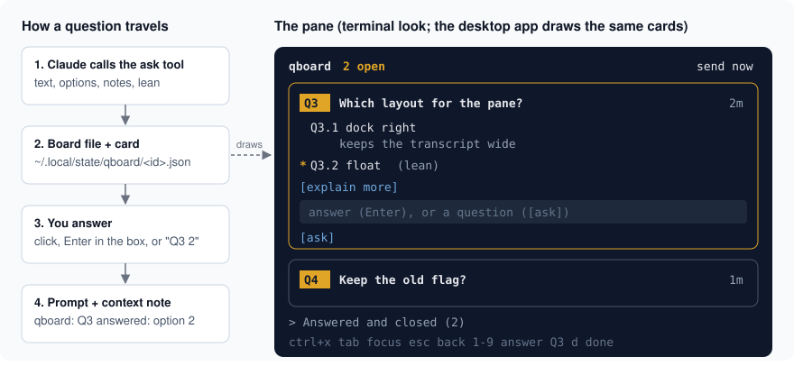
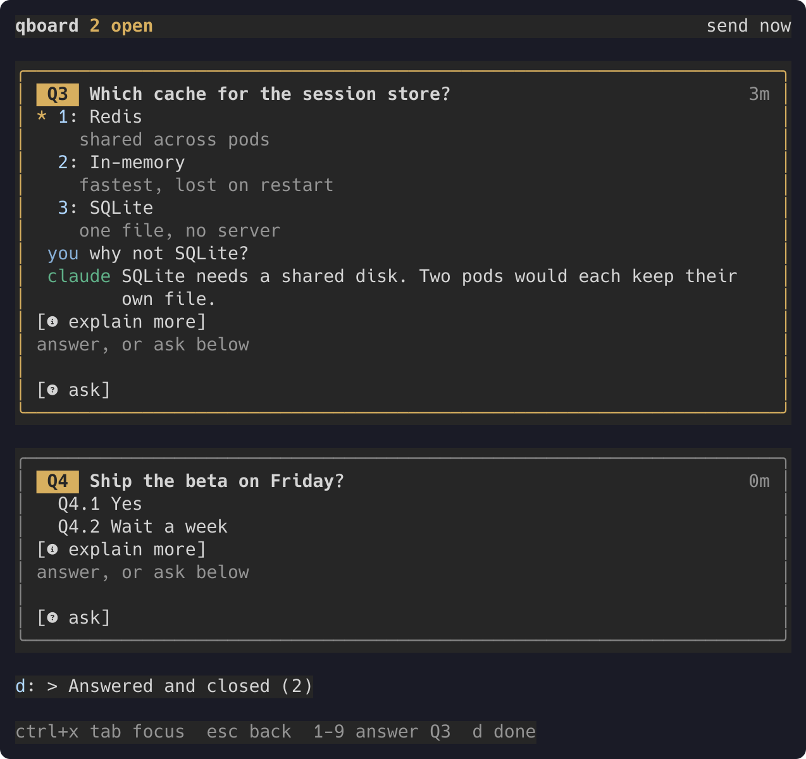

# qboard

A question board for Claude Code. When Claude needs a decision from you, it puts the question on a side pane with a stable id (`Q3`), its options and its lean, and writes only `Q3 on board` in chat. You answer with a click in the pane or by typing `Q3 2` in the prompt. Answered questions stay on the board, so a long session keeps a record of what you decided.



Claude calls `mcp__qboard__ask`. The plugin saves the question to the session's board file and draws a card. You answer on the card or in the prompt. The answer goes to Claude as a normal prompt, with a short `qboard:` note that names the question and the option, so Claude never has to guess what `2` meant.

## Install

In a Claude Code session:

```
/plugin install qboard --marketplace llkhacquan/claude-mods
```

Answer `y` to add the marketplace, then pick the user scope so every session has the board. The same in two steps:

```
/plugin marketplace add llkhacquan/claude-mods
/plugin install qboard@claude-mods
```

In the terminal the pane shows at once, no restart needed. To try it, ask Claude for something with a choice in it, for example "pick a cache for the session store and ask me before you start". To remove it: `/plugin uninstall qboard@claude-mods`.

It works in the terminal and in the Claude desktop app (Code tab), with a pane drawn for each: plain text with key hints in the terminal, buttons and pills in the desktop app. Both show the same cards and do the same things. The desktop app loads a newly installed or updated plugin only after a restart.

## Use



The pane opens when a session starts. `/qboard` hides or shows it. While questions are open, a band above the prompt lists their ids, with an `[open]` button that brings the pane back.

Where the pane shows is Claude Code's choice. In the fullscreen layout (set `CLAUDE_CODE_NO_FLICKER=1`, for example in the `env` block of `settings.json`) it docks on the right of the transcript when the terminal is at least 110 columns wide, and it scrolls on its own. On the main screen (the default inside tmux) it sits above the prompt.

Answer a question in any of these ways:

| You do | It means |
|--------|----------|
| Click an option (in the terminal, `1`-`9` picks one on the top card) | Pick that option |
| Type `Q3 2`, `Q3.2` or `Q3 2, Q4 1` in the prompt | Pick option 2 of Q3 (and option 1 of Q4) |
| Type a bare `2` | Pick option 2 of the oldest open question |
| Type an answer in the card's box and press Enter | A free-text answer |
| Type `Q3 <words>` in the prompt | Claude reads it and decides: an answer, a question about Q3, or a change to Q3 |
| `[explain more]`, or type `Q3 explain more` | Claude replies under the card |
| Type a question in the box and press `[ask]`, or type `Q3 ? <question>` | Claude replies under the card |

Each answer from the pane is sent as a normal prompt (`Q3 2 (float)`), and the prompt carries a short note that tells Claude which question and option it was. Text pasted from Claude's own reply, such as an option list or a `Q3 on board` line, is never read as an answer.

The button at the top right switches between two modes:

- `send now`: a press sends the answer at once.
- `fill prompt`: a press puts the answer in the prompt box, so you can add to it before you press Enter.

While Claude is busy, an answer waits in a queue and is sent when the turn ends. A card with a queued answer is locked, so a second press can not race it. After five failed tries the answer is put in the prompt box instead.

A path in a question, a note or a reply (`docs/plan.html`, `~/notes/a.md`) gets an open button on the card when the file exists.

The `Answered and closed` row at the bottom (`d` in the terminal) shows the last five done questions.

## Tools

The plugin gives Claude five tools:

| Tool | What it does |
|------|--------------|
| `mcp__qboard__ask` | Put a question on the board: text, options, one note per option, and the option it leans to |
| `mcp__qboard__answer` | Mark a question answered when you answered in plain words and no option was matched |
| `mcp__qboard__explain` | Reply under a card, after `explain more` or a question about it |
| `mcp__qboard__edit` | Rewrite an open question in place, same id |
| `mcp__qboard__close` | Take a question off the board without an answer |

When a turn ends on a question written only in chat (a list of options, a `Lean 2` line, an "Unresolved questions" list), the plugin sends one reminder that asks Claude to put it on the board. It does this only in interactive sessions, at most once per turn, and never for a turn in which Claude already asked or edited a question on the board.

## Where the board lives

- One file per session: `~/.local/state/qboard/<session id>.json`.
- `/clear` carries the board to the new session. `/resume` loads the board of the resumed session.
- A launcher that starts a new process to take over a session can set `QBOARD_FROM=<old session id>`: the first session of that process then starts with the old board.
- A new session removes boards not written for 7 days that have no open question, and any board not written for 30 days.

## Develop

```bash
claude plugin validate plugins/qboard
claude plugin test plugins/qboard
npx -p typescript tsc -p plugins/qboard
```

`tsc` needs `.claude-plugin/types/`, which is not in the repo. Claude Code writes that folder the first time it loads the mod: start one session with `claude --plugin-dir plugins/qboard`.
